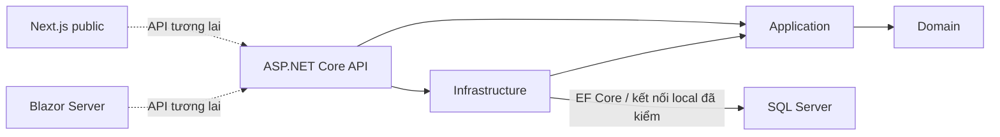
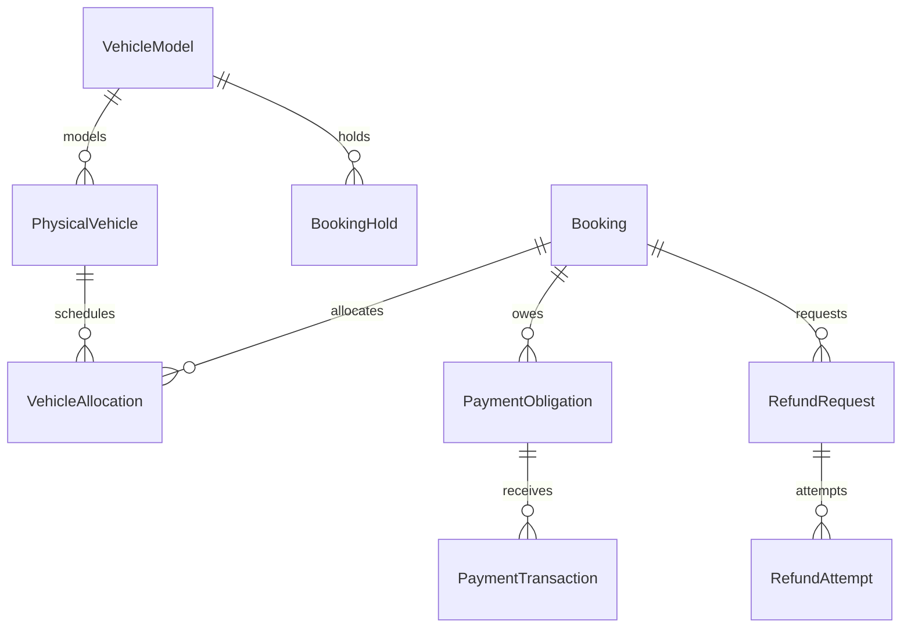

# Kiến trúc

13/11: media contracts ở Application, SkiaSharp processor/storage/shared endpoint adapter ở Infrastructure để API và Admin cùng dùng. CatalogImageService phối hợp metadata/audit SQL + file compensation, khóa ảnh theo model/rowversion; không đổi schema và không đụng Fleet. File ngoài wwwroot, GUID v7/date UTC, CreateNew; public content encode một lần/immutable URL, preview private no-store; private originals không encode và được mã hóa Data Protection, không có route public. UI multipart HTTP mới giữ authorization/CSRF theo request, tái dùng NotificationService/form JS. Purpose do module server chọn, không nhận tùy ý từ client. [Thiết kế và giới hạn](../Changes/2026-11-13-upload-anh-guid-v7-cache.md).

Checkpoint 12/11: CatalogFleetCommandService được tách partial theo workflow (file chính, CatalogFleetLifecycleService, CatalogFleetProfileService), vẫn cùng DI/DbContext/actor. Lifecycle/profile/registration cùng khóa xe với bảo trì; profile lấy khóa VIN toàn fleet trước khóa xe, registration lấy khóa xe rồi khóa biển toàn fleet. Version xe bắt buộc; đóng biển cũ trước insert biển mới trong cùng transaction. DbContext chặn sửa định danh/xóa registration và mọi sửa row đã đóng, chỉ cho đóng interval hiện hành đầy đủ. Không thay schema/dependencies. UI SSR chi tiết xe dùng lại FleetForm/NotificationService, chỉ fill profile trên GET và giữ input/version POST. Chi tiết tại FLEET_LIFECYCLE_CONTRACT.md; SQL mới 200+36 PASS, browser còn chưa kiểm.

## Hiện thực



API composition root đăng ký AddApplication, AddInfrastructure, Identity, ProblemDetails, OpenAPI, Swagger Development và health checks. Domain thuần C#; Application có contracts/actor abstraction, Infrastructure hiện thực các workflow Catalog/Fleet. Frontend chưa gọi API nghiệp vụ; Admin đã đăng nhập và dùng cùng Identity store với API, màn hình CRUD còn ở lát sau.

SangRentalDbContext kế thừa IdentityDbContext, map 16 entity Catalog/Fleet trong schema `sangrental` và 8 bảng Identity/security audit trong schema `identity`. Không cần DbSet properties để dùng EF Set<T>. Hai migration đầu đã áp dụng Development. Migration Identity chỉ đã áp dụng SangRentalTestDb theo phê duyệt; không Migrate/EnsureCreated/seed trong API/Admin startup. Credentials chỉ từ configuration. ERD Catalog/Fleet ở PHASE_3_CATALOG_FLEET_ERD; các nhãn chưa triển khai trong bản thiết kế cũ là lịch sử.

Phase 2 đã kiểm DI → SangRentalDbContext → Database.CanConnectAsync tới SangRentalDb Docker, ready 200 bằng User Secrets Development. Connection key SangRental giữ nguyên. Development opt-in `SqlServer:UseIPv4Loopback` chuyển đúng localhost,1436 thành tcp:127.0.0.1,1436 vì Docker bind IPv4; không đổi TLS/credential/model. Không thêm EF vào Domain/Application. Xem PHASE_2_DATABASE_CONNECTION_REPORT.md.

Identity scheme dùng chung `Identity.Application`, cookie `__Host-SangRental.Admin` HttpOnly/Secure/Strict, TTL 30 phút, không remember-me/sliding. API/Admin dùng chung Data Protection application name `SangRental.Admin.Identity.v1`; local cùng OS user dùng key ring mặc định. Nếu đặt KeyDirectory thì Windows dùng DPAPI; production cần key ring dùng chung được bảo vệ, HTTPS, cấu hình reverse proxy riêng.

Mỗi HTTP request có cookie kiểm security stamp, trạng thái active/lockout và regenerate role/permission từ database. Logout cập nhật security stamp để vô hiệu cả cookie đã sao chép. Blazor circuit revalidate mỗi phút; mutation phải đi qua backend HTTP được kiểm quyền lại, không tin principal cũ trong circuit. Admin toàn quyền Catalog/Fleet; Manager chỉ có các claim fleet.manage/fleet.approve/catalog.publish được cấp; Staff không có quyền fleet mặc định. Chưa có giao diện/API cấp quyền hoặc MFA enrollment.

API JSON mutation và form login/logout yêu cầu antiforgery; Swagger interceptor lấy token theo principal hiện thời. Không đăng ký công khai. Bootstrap tương tác chỉ tạo Admin đầu tiên; chế độ --test-database cho tạo Admin test bổ sung, chỉ tại đúng SangRentalTestDb và endpoint SQL loopback đã allowlist. Audit/inspection/status events bị chặn sửa/xóa qua DbContext; quyền SQL ít quyền/append-only ngoài EF vẫn là gate hạ tầng.

Maintenance commands khóa ứng dụng theo xe trước khi đọc entity để cập nhật, trong transaction Serializable. Đợt quá giờ chưa release tiếp tục chặn; không tự Ready theo đồng hồ. Checklist/complete HTTP dùng If-Match. Đây không phải protocol inventory/booking hoàn chỉnh; chưa có worker kích hoạt đợt Planned hoặc cảnh báo xung đột booking.

## Mô hình tương lai — chưa hiện thực

Admin Fleet hiện có SSR `/fleet`, `/fleet/vehicles/{id}`, `/fleet/maintenance/{id}` cho tạo/xem xe và bảo trì/checklist/release. Page yêu cầu AdminAccess; POST mới dùng CatalogFleetSetupService/CommandService trong request scope. FleetUiService chuyển giờ Việt Nam↔UTC và quản lý protected flash. Rowversion lấy từ POST, membership task/episode xác minh tại server. JS chỉ confirm/loading/chống submit lặp qua notification adapter, không quyết định trạng thái xe. Lịch trùng/release/audit vẫn do transaction/lock và service hiện có xử lý. Đây chưa phải module availability hay lifecycle đầy đủ.

Checkpoint Admin 11/11: trang `/catalog` render SSR, ba EditForm POST chạy trong request scope mới với AdminAccess/antiforgery. Ghi qua CatalogFleetSetupService hiện có; không ghi từ circuit. UI tạo/đọc category/brand/model, phân trang 50/nhóm, validation inline; success flash cookie dùng Data Protection và NotificationService. Chưa có UI fleet hoặc đầy đủ CRUD. API JSON và SSR adapter cùng dùng transaction/audit/guard trong Infrastructure.

State machines độc lập: BookingLifecycle, Hold, PaymentObligation/Transaction, VehicleOperational, Allocation, Handover/Return, Extension, Dispute, RefundRequest/Attempt, OfflineSync. Bảng transitions nguồn ở đặc tả mục 5; trước implementation cần khóa from/event/guard/to/side effects/actor/idempotency/error theo module.



Đây chỉ là quan hệ định hướng. FK/index/precision/schema chi tiết sẽ khóa theo module (đặc tả mục 7). Rowversion và unique index không đủ chống overlap: cần transaction/serializable hoặc khóa phù hợp cùng SQL Server concurrency tests thật. Lịch `[start,end)`, lưu UTC, hiển thị Asia/Ho_Chi_Minh; tách scheduled return/actual received/ready-at và không cộng buffer hai lần.

```mermaid
sequenceDiagram
  participant Client
  participant API
  participant SQL
  participant Provider
  Client->>API: Yêu cầu giữ mẫu xe (tương lai)
  API->>SQL: Transaction capacity + hold 15 phút
  Provider->>API: Webhook đã xác thực (tương lai)
  API->>SQL: Idempotency + amount/reference/account + allocation
  alt Hold hợp lệ và còn xe
    API->>SQL: Confirm + outbox trong transaction
  else Trễ / thiếu xe / sai tiền
    API->>SQL: Lưu payment + reconciliation; không confirm
  end
```

Failure recovery tương lai: transaction rollback, idempotency, outbox retry/backoff/dead-letter, audit bất biến; refund unknown chặn retry; offline input cần xác minh. Chưa có worker/provider adapter. Tiền decimal precision cố định; thứ tự giảm/làm tròn chưa hiện thực.

## Stitch

Chuẩn bổ sung chính thức: [UIUX_V27_ADDENDUM.md](UIUX_V27_ADDENDUM.md) đối chiếu với nguồn v2.7; [DESIGN_SYSTEM.md](DESIGN_SYSTEM.md) khóa tokens/API/i18n và phân định popup với UI thông thường. Shared CSS nguồn ở frontend/src/design/coastal.css được copy sang admin. Semantic tokens của hai ứng dụng dùng Ocean/Navy/Ivory; surface xanh Stitch vẫn làm màu hỗ trợ. Notification core xử lý reject của loading theo ownership, không mở khóa tác vụ khác; key không tồn tại bị từ chối trước khi hiển thị.

Quy chuẩn UI/UX bổ sung áp dụng cho thông báo/icon: SweetAlert2 dùng Ocean Blue #087EA4, Turquoise #16B8B0, Sand Gold #EBCB83, Deep Navy #123C50, Warm Ivory #FFF9EE. Font Awesome chỉ import icon thực dùng, ẩn icon trang trí khỏi screen reader. NotificationService lazy-load client-side ở Next, C# JS Interop ở Blazor; shared core + sáu locale sinh sang wwwroot/vendor bằng scripts/prepare-ui-assets.mjs. Không gọi Swal.fire trong business component, không dùng HTML không tin cậy. Static vendor assets được giữ license; chạy lại script sau cập nhật dependency.

Nền #f5faff, chữ #001e2c, primary #087ea4, secondary #006a65; card trắng bo góc; desktop grid/mobile stack. Hiện chỉ header/hero/danh mục/footer. Không tái sử dụng review, lượng xe, số điện thoại/địa chỉ, giá, SLA hoặc phương thức thanh toán chưa xác minh. Mức giảm 3/5/6 ngày trong Stitch không ghi đè quy tắc 3/7/15/30 từ nguồn.
