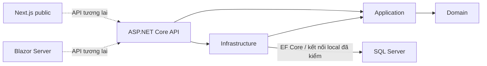
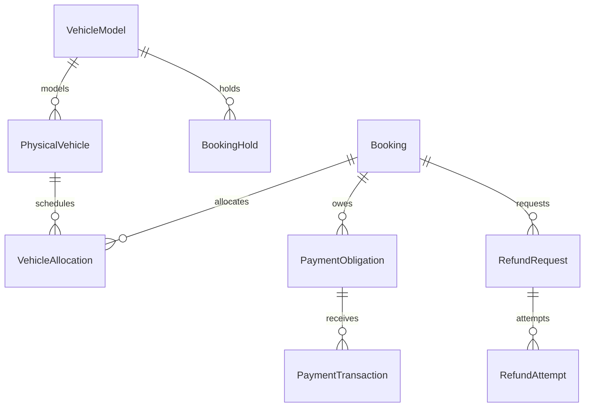

# Kiến trúc

## Hiện thực



API composition root đăng ký AddApplication, AddInfrastructure, ProblemDetails, OpenAPI và health checks. Domain thuần C#; Application mới có TimeProvider.System, chưa use case. Frontend/admin chưa gọi API nghiệp vụ.

DbContext SQL Server chưa DbSet. Schema mặc định `sangrental` là chuẩn bị, migration rỗng không tạo bảng nghiệp vụ. Provider được cấu hình không connection để sinh model design-time. Không Migrate/EnsureCreated/seed startup. Credentials chỉ từ configuration. Không có ERD vật lý nghiệp vụ hiện tại.

Phase 2 đã kiểm DI → SangRentalDbContext → Database.CanConnectAsync tới SangRentalDb Docker, ready 200 bằng User Secrets Development. Connection key SangRental giữ nguyên. Development opt-in `SqlServer:UseIPv4Loopback` chuyển đúng localhost,1436 thành tcp:127.0.0.1,1436 vì Docker bind IPv4; không đổi TLS/credential/model. Không thêm EF vào Domain/Application. Xem PHASE_2_DATABASE_CONNECTION_REPORT.md.

Admin cookie HttpOnly/Secure/Strict, fallback authenticated, dashboard và `/auth/session` yêu cầu AdminAccess. Chưa cấp cookie vì chưa có nguồn danh tính. Không chia sẻ cookie/Data Protection key với API. Auth liên ứng dụng phải chốt trước module đầu tiên.

## Mô hình tương lai — chưa hiện thực

State machines độc lập: BookingLifecycle, Hold, PaymentObligation/Transaction, VehicleOperational, Allocation, Handover/Return, Extension, Dispute, RefundRequest/Attempt, OfflineSync. Bảng transitions nguồn ở đặc tả mục 5; trước implementation cần khóa from/event/guard/to/side effects/actor/idempotency/error theo module.



Đây chỉ là quan hệ định hướng. FK/index/precision/schema chi tiết sẽ khóa theo module (đặc tả mục 7). Rowversion và unique index không đủ chống overlap: cần transaction/serializable hoặc khóa phù hợp cùng SQL Server concurrency tests thật. Lịch `[start,end)`, lưu UTC, hiển thị Asia/Ho_Chi_Minh; tách scheduled return/actual received/ready-at và không cộng buffer hai lần.

```mermaid
sequenceDiagram
  participant Client
  participant API
  participant SQL
  participant Provider
  Client->>API: Yêu cầu giữ mẫu xe (tương lai)
  API->>SQL: Transaction capacity + hold 15 phút
  Provider->>API: Webhook đã xác thực (tương lai)
  API->>SQL: Idempotency + amount/reference/account + allocation
  alt Hold hợp lệ và còn xe
    API->>SQL: Confirm + outbox trong transaction
  else Trễ / thiếu xe / sai tiền
    API->>SQL: Lưu payment + reconciliation; không confirm
  end
```

Failure recovery tương lai: transaction rollback, idempotency, outbox retry/backoff/dead-letter, audit bất biến; refund unknown chặn retry; offline input cần xác minh. Chưa có worker/provider adapter. Tiền decimal precision cố định; thứ tự giảm/làm tròn chưa hiện thực.

## Stitch

Chuẩn bổ sung chính thức: [UIUX_V27_ADDENDUM.md](UIUX_V27_ADDENDUM.md) đối chiếu với nguồn v2.7; [DESIGN_SYSTEM.md](DESIGN_SYSTEM.md) khóa tokens/API/i18n và phân định popup với UI thông thường. Shared CSS nguồn ở frontend/src/design/coastal.css được copy sang admin. Semantic tokens của hai ứng dụng dùng Ocean/Navy/Ivory; surface xanh Stitch vẫn làm màu hỗ trợ. Notification core xử lý reject của loading theo ownership, không mở khóa tác vụ khác; key không tồn tại bị từ chối trước khi hiển thị.

Quy chuẩn UI/UX bổ sung áp dụng cho thông báo/icon: SweetAlert2 dùng Ocean Blue #087EA4, Turquoise #16B8B0, Sand Gold #EBCB83, Deep Navy #123C50, Warm Ivory #FFF9EE. Font Awesome chỉ import icon thực dùng, ẩn icon trang trí khỏi screen reader. NotificationService lazy-load client-side ở Next, C# JS Interop ở Blazor; shared core + sáu locale sinh sang wwwroot/vendor bằng scripts/prepare-ui-assets.mjs. Không gọi Swal.fire trong business component, không dùng HTML không tin cậy. Static vendor assets được giữ license; chạy lại script sau cập nhật dependency.

Nền #f5faff, chữ #001e2c, primary #087ea4, secondary #006a65; card trắng bo góc; desktop grid/mobile stack. Hiện chỉ header/hero/danh mục/footer. Không tái sử dụng review, lượng xe, số điện thoại/địa chỉ, giá, SLA hoặc phương thức thanh toán chưa xác minh. Mức giảm 3/5/6 ngày trong Stitch không ghi đè quy tắc 3/7/15/30 từ nguồn.
