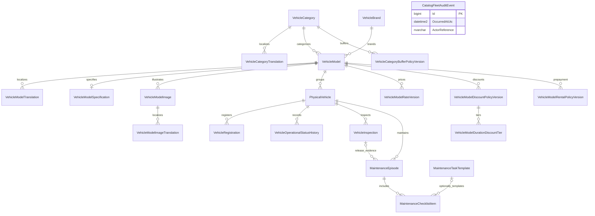
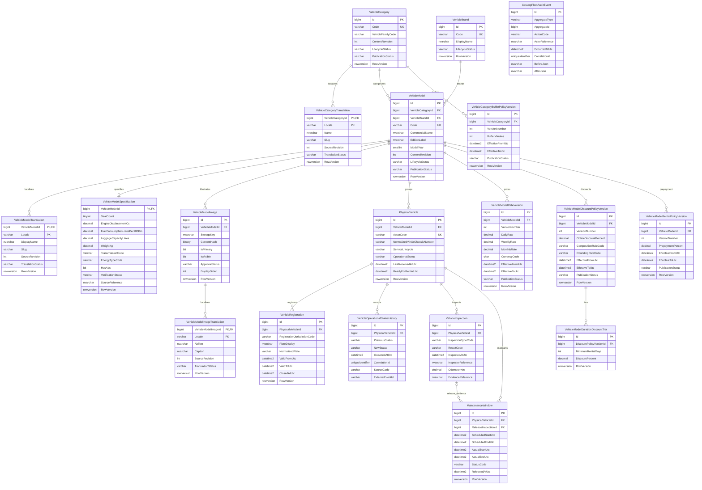
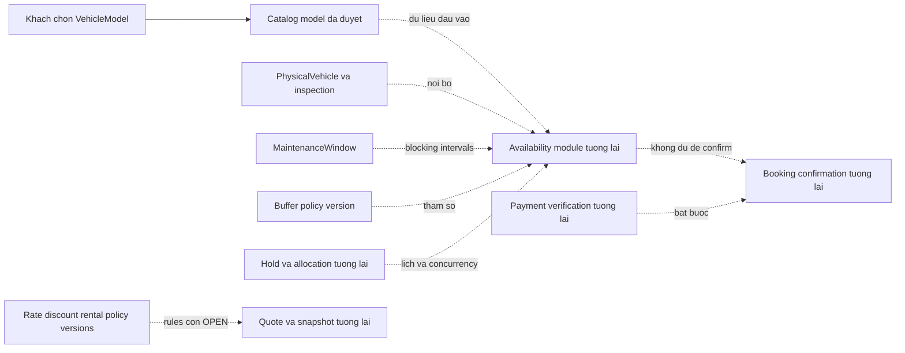

# Phase 3 — Catalog & Fleet ERD

**DESIGN REVIEW — NOT APPROVED**  
Ngày: 08/11/2026. Revision 6 (chọn phạm vi, lifecycle hồ sơ và nguồn thông số). Tất cả bảng, PK/FK và cardinality ở đây là **PROPOSED**, chưa có trong SQL Server hoặc EF model. Nguồn chi tiết: [schema proposal](PHASE_3_CATALOG_FLEET_SCHEMA_PROPOSAL.md). Các quyết định chưa duyệt: [decision log](PHASE_3_SCHEMA_DECISION_LOG.md).

Theo Q37–Q38, `VehicleModelSpecification` lưu nguồn xác minh theo từng trường ABS, dung tích động cơ và số ghế khi các giá trị đó công khai. Quan hệ ERD không đổi; cột và guard cụ thể ở proposal Revision 6.

Theo Q36, quan hệ `PhysicalVehicle ||--o{ VehicleInspection` bắt buộc có một bản ghi Passed được tạo cùng transaction khi Admin kích hoạt xe Ready ngay lúc tạo. ERD không thể hiện ràng buộc điều kiện xuyên bảng này bằng cardinality; cần guard ở application và kiểm thử tích hợp trước khi cho thuê.

Theo Q34–Q35, `PhysicalVehicle` có trạng thái hồ sơ Draft/Active/Retired đề xuất, tách khỏi `OperationalStatus` (ví dụ PendingInspection/Ready). Admin chọn Ready khi tạo và xác nhận kiểm tra sẽ chuyển hồ sơ Draft sang Active khi lưu. Quan hệ ERD giữ nguyên; không phát sinh entity mới.

**Migration đầu theo Q29:** lấy 16 entity Catalog/Fleet/checklist trong ERD Revision 2 phía dưới; **loại** `VehicleModelRateVersion`, `VehicleModelDiscountPolicyVersion`, `VehicleModelDurationDiscountTier`, `VehicleModelRentalPolicyVersion`, `VehicleCategoryBufferPolicyVersion` khỏi migration đầu. ERD đầy đủ vẫn vẽ 21 entity để giữ kế hoạch lát sau. `VehicleRegistration` có thể rỗng cho unit Ready; bàn giao cần biển theo Q31–32. Hard delete bản nháp không liên quan theo Q33 cần định nghĩa draft của PhysicalVehicle trước mapping. Chưa có phê duyệt migration SQL.

## ERD Revision 2 — 21 entity đề xuất, hiện hành để review

Các câu trả lời Q1–Q28 được ghi trong proposal. `MaintenanceEpisode` thay `MaintenanceWindow`; thêm danh mục việc bảo trì và checklist. Sơ đồ Revision 1 phía dưới chỉ còn để đối chiếu lịch sử, **không dùng làm cơ sở migration**. `PhysicalVehicle.VIN` không có unique constraint; chỉ index tra cứu và cảnh báo trùng. `MaintenanceEpisode.ScheduledEndUtc` nullable. Giá mới được lưu thành version có hiệu lực ngay. Cấu trúc vật lý vẫn chưa được phê duyệt.

Audit event không có FK tới User vì identity chưa chốt. Không có bảng Booking, Payment hoặc Authentication. Published model chưa có giá vẫn có thể cho Liên hệ; CTA Đặt ngay phụ thuộc khả dụng theo khoảng do backend tương lai xác định, không suy từ quan hệ ERD.

## ERD Revision 1 — 19 entity, lưu để đối chiếu, đã bị thay thế

Mermaid chỉ thể hiện các cột chính; dictionary trong proposal là nguồn đầy đủ. Các cột M/A lặp lại được lược bớt. `PK, FK` là shared/composite key thật được đề xuất; không tạo Id giả cho translations. Không có bảng Booking/Payment/User trong ERD này.

## Cardinality, optionality và bảo toàn

| Quan hệ | Cardinality | Ý nghĩa / guard ngoài FK |
|---|---|---|
| Category → Model; Brand → Model | 1 → 0..N; model bắt buộc đúng một mỗi loại | Không tự many-to-many hoặc hierarchy; parent Active là guard application |
| Category/Model → Translation | 1 → 0..N | Composite PK owner+locale; CHECK sáu locale cho tối đa sáu row mỗi owner. FK không đảm bảo ít nhất row vi reviewed |
| Model → Specification | 1 → 0..1 | Shared PK/FK; draft có thể chưa có. Publication coverage cần review S-05/S-10 |
| Model → Image → ImageTranslation | 1 → 0..N → 0..N | Mỗi ảnh một model; primary unique filtered. Không buộc ít nhất ảnh bằng relationship |
| Model → PhysicalVehicle | 1 → 0..N | Mỗi unit đúng một model; không chỉnh quan hệ làm đổi lịch sử sau phát sinh sử dụng |
| Unit → Registration | 1 → 0..N | Lịch sử đăng ký; filtered unique giới hạn tối đa một row current/unit, không phải 1:1 lifetime |
| Unit → StatusHistory/Inspection/Maintenance | 1 → 0..N | Không cascade delete; lịch sử append-only hoặc mutation có audit |
| Inspection → Maintenance release | 0..1 inspection/window; một inspection được 0..N window tham chiếu | FK nullable chưa chứng minh cùng unit hoặc passed; S-07 có thể siết composite FK/unique sau review |
| Model → Rate/Discount/RentalPolicy versions | 1 → 0..N mỗi loại | Version number unique theo model; không đồng nghĩa chỉ một interval có hiệu lực |
| DiscountVersion → DurationTier | 1 → 0..N | Mốc unique; parent published thì child bất biến |
| Category → BufferPolicyVersion | 1 → 0..N | Không default buffer khi chưa policy; interval overlap cần transaction |
| Root → AuditEvent | Logical 1 → 0..N, không đường FK trong ERD | AggregateType+AggregateId là logical reference; app guard + atomic write, chưa có polymorphic FK SQL |

Các row mutable dùng audit group M, row append-only dùng A như proposal. Tất cả FK đề xuất NO ACTION; không dùng cascade để dọn lịch sử, không coi `Retired` là `Deleted`. Nullability đầy đủ nằm ở dictionary, không suy từ sơ đồ rút gọn.

## Ranh giới với các module chưa thiết kế/triển khai

Sơ đồ sau chỉ là phụ thuộc khái niệm, **không thêm entity/FK vào proposal**:

Không đường từ khách chọn tới PhysicalVehicle/VehicleRegistration. Không tuyên bố COUNT(Ready) là availability; không suy price version là verified payment; không vẽ trạng thái booking mới.

## Tự kiểm thiết kế

- Có 19 entity trong ERD, cùng inventory của proposal; `VehicleVariant`, `Manufacturer`, `Booking`, `Payment`, `User` không được đưa thành bảng ngầm.
- Mỗi FK vẽ ở ERD có cột trong dictionary; audit polymorphic không được vẽ như FK thật.
- Chỉ quan hệ 1–0..1 là shared-PK specification; bảng registration có lịch sử nên không ép một-một lifetime.
- Đây là review tĩnh, không phải EF generated model/SQL plan hoặc kiểm SQL constraints đã chạy. Chưa xác minh renderer Mermaid thực tế ở viewer người dùng; không coi sơ đồ là migration đã hợp lệ.
